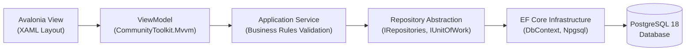

# Laboratory Activity 4 — Use Case Diagram & System Model

## System Overview
- **System**: Campus Equipment Borrowing System
- **Operational Database**: PostgreSQL 18 with Entity Framework Core 10
- **Primary Actor**: Laboratory Staff / Equipment Custodian

---

## Mermaid UML Use Case Diagram

```mermaid
flowchart TD
    subgraph System["Campus Equipment Borrowing System (PostgreSQL 18)"]
        %% Existing Continuations (UC-01 to UC-05)
        UC01["UC-01: View Equipment Catalog"]
        UC02["UC-02: Find Available Equipment"]
        UC03["UC-03: Borrow Equipment (Single Item)"]
        UC04["UC-04: View Active Borrowings"]
        UC05["UC-05: Return Equipment"]

        %% Required New Use Cases (UC-06 to UC-09, UC-12 to UC-16)
        UC06["UC-06: Check Out Multiple Equipment Items (Atomic Multi-Item)"]
        UC07["UC-07: View Student Borrowing History"]
        UC08["UC-08: View Equipment Borrowing History"]
        UC09["UC-09: Search, Filter, and Sort Borrowings"]
        
        UC12["UC-12: Register Student"]
        UC13["UC-13: Update Student Information"]
        UC14["UC-14: Change Student Borrowing Eligibility"]
        
        UC15["UC-15: Register Equipment"]
        UC16["UC-16: Update Equipment Information"]
    end

    Actor["👤 Laboratory Staff / Equipment Custodian"]

    %% Actor Connections
    Actor --> UC01
    Actor --> UC02
    Actor --> UC03
    Actor --> UC04
    Actor --> UC05
    Actor --> UC06
    Actor --> UC07
    Actor --> UC08
    Actor --> UC09
    Actor --> UC12
    Actor --> UC13
    Actor --> UC14
    Actor --> UC15
    Actor --> UC16

    classDef primary fill:#1E293B,stroke:#3B82F6,stroke-width:2px,color:#F8FAFC;
    classDef actor fill:#0F172A,stroke:#10B981,stroke-width:2px,color:#F8FAFC;
    class UC01,UC02,UC03,UC04,UC05,UC06,UC07,UC08,UC09,UC12,UC13,UC14,UC15,UC16 primary;
    class Actor actor;
```

---

## Use Case Classification & Scope

| Use Case ID | Use Case Name | Activity 4 Classification | Primary Responsibility |
|:---|:---|:---|:---|
| **UC-01** | View Equipment Catalog | Required continuation | Retrieve and display all hardware records with availability states |
| **UC-02** | Find Available Equipment | Required continuation | Filter inventory to only items currently eligible for loan |
| **UC-03** | Borrow Equipment | Required continuation | Issue a single available item to an eligible student within limit |
| **UC-04** | View Active Borrowings | Required continuation | Display all unreturned equipment loans with due dates |
| **UC-05** | Return Equipment | Required continuation | Process return of an active loan, recording return timestamp |
| **UC-06** | Check Out Multiple Items | **Required new** | Atomic transaction checkout of $\ge 2$ items for an eligible student |
| **UC-07** | View Student Borrowing History | **Required new** | Asynchronously retrieve complete active & returned loans for a student |
| **UC-08** | View Equipment Borrowing History| **Required new** | Asynchronously retrieve complete loan lifecycle records for an item |
| **UC-09** | Search, Filter & Sort Borrowings| **Required new** | Multi-criteria query engine (text search, status filter, multi-field sort) |
| **UC-12** | Register Student | **Required new** | Create unique student record with institutional student number |
| **UC-13** | Update Student Information | **Required new** | Modify full name and contact info while preserving loan history |
| **UC-14** | Change Student Eligibility | **Required new** | Permit or restrict student borrowing without affecting active loans |
| **UC-15** | Register Equipment | **Required new** | Add new physical hardware item with unique inventory identifier |
| **UC-16** | Update Equipment Information | **Required new** | Edit descriptive fields while protecting availability and status fields |

---

## Clean Architecture Flow Diagram

